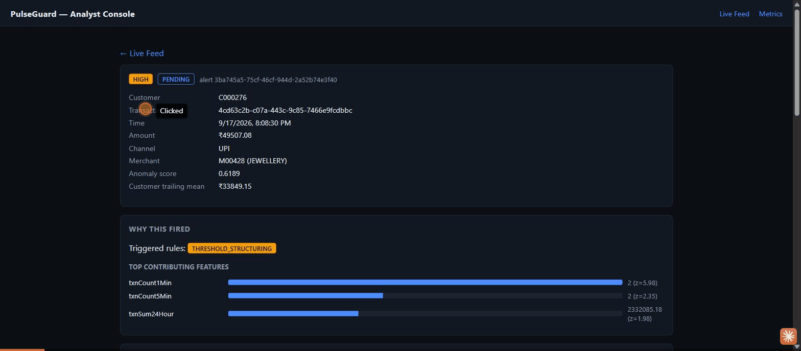
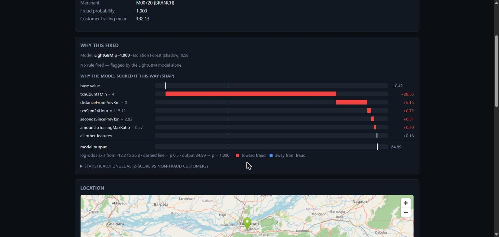
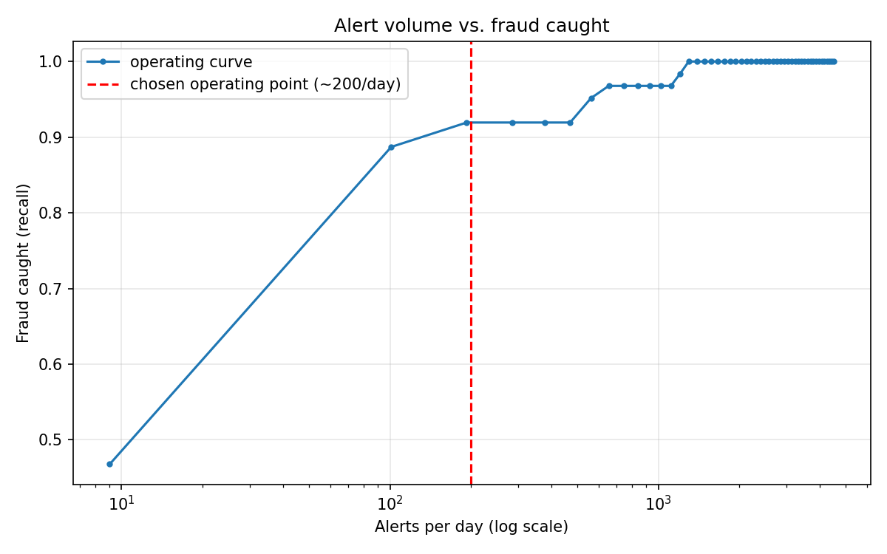
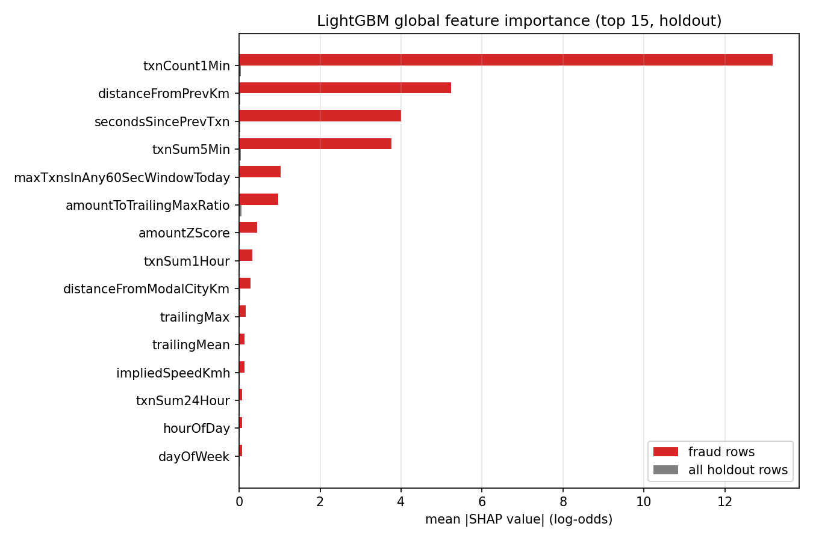
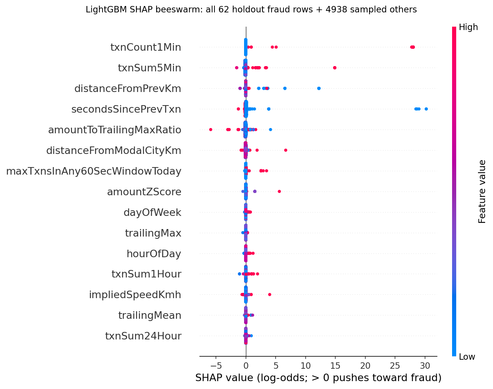

# PulseGuard — Real-Time Transaction Monitoring & Fraud Detection Pipeline

Synthetic UPI, card, and NEFT transactions stream through Kafka, get scored
for fraud in real time by a hybrid rules + LightGBM detection layer (with
an Isolation Forest scoring every transaction in shadow), and surface to
an analyst console with an exact per-alert SHAP explanation. Analyst
decisions feed back into a label store for retraining, and a nightly batch
layer tracks fraud rate, per-rule precision, and feature drift.

The engineering emphasis is on streaming semantics that matter in a real
transaction-monitoring system: partition-by-customer for ordered stateful
processing, watermarked late-event handling, exactly-once delivery via
checkpointed offsets and idempotent sinks, and a single feature store shared
between training and serving so the two never drift apart.



*Recorded against the actual `docker compose up` stack with live traffic
flowing: new alerts arriving on the feed, opening a model-only alert
(LightGBM p = 2.9e-4, Isolation Forest shadow 0.54), its SHAP waterfall
(evening hour and an amount 2.8x the customer's trailing max pushing it
up from the −10.42 base value), the collapsed "statistically unusual"
z-score view, a real disposition (note + False Positive), and the metrics
page.* A second live alert, a high-confidence one:



*A live alert from the running stack: a model-only card-testing catch.
LightGBM starts from its base value (−10.42 log-odds), four transactions
in the last minute push it +28.55, being in the exact same place as the
previous transaction another +5.15, and it ends at 24.99 → p = 1.000. The
Isolation Forest, scoring in shadow, gave it 0.58.*

## Status

This project is being built incrementally, in phases. Checked items are
implemented and tested; unchecked items are planned.

- [x] **Phase 1 — Generator & ingestion infra.** Behavioural customer
      population (5 archetypes), 6 labelled fraud patterns, a Kafka
      producer capable of both a realistically-paced historical stream and
      a rate-controlled load-test firehose, and the Kafka/Redis/Postgres
      Docker Compose stack with topics provisioned.
- [x] **Phase 2 — Streaming feature computation.** Spark Structured
      Streaming job computing 26 rolling behavioural features per customer
      via a stateful per-key operator, a watermarked sliding-window
      aggregation demo, dead-letter routing for malformed records, and a
      Redis online feature store — verified end-to-end against live Kafka.
- [x] **Phase 3 — Detection layer.** A safe (no-`eval`) versioned rule
      engine, a LightGBM champion with an Isolation Forest in shadow, an
      alert threshold calibrated to analyst review capacity, and exact
      per-alert TreeSHAP explanations — wired live into the Spark job and
      verified producing real alerts to `fraud.alerts`. (LightGBM started
      as an offline benchmark next to an Isolation Forest scorer before
      being switched to serving.)
- **Phase 4 — Serving & analytical layer.**
  - [x] NestJS alert service: consumes `fraud.alerts`, persists idempotently
        to Postgres, broadcasts over WebSocket, serves REST history/detail,
        and captures analyst disposition back to `analyst.dispositions` —
        verified end-to-end including live WebSocket push.
  - [x] Next.js analyst console: live feed (WebSocket-pushed, severity
        colour-coded), drill-down (transaction, triggered rules, top
        feature contributions, an OpenStreetMap embed, the customer's
        other recent alerts), and disposition capture — verified in an
        actual browser against the live stack, including a real
        disposition round-trip and the metrics dashboard updating from it.
  - [x] Delta Lake bronze layer (skipping silver, a deliberate
        scope cut) written continuously by the Spark job, plus a
        nightly batch job (a plain Python script standing in for Airflow)
        computing gold aggregates, PSI drift, data quality gates, and a
        report-only champion-vs-challenger retrain check — verified against
        real bronze data, including two real bugs it surfaced along the way.
- [x] **Phase 5 — Load testing & failure drills.** Real measured throughput
      and latency numbers (including a full-pipeline bottleneck that isn't
      what the raw producer numbers suggest), a driver-kill drill with a
      global zero-loss/zero-duplication check, a Redis-outage drill that
      exposed and fixed a real crash-vs-degrade bug, and a dead-letter
      drill — see below for all of it, including two more real bugs found
      by actually running these tests rather than assuming they'd pass.

## Architecture

```
Transaction Generator (Python, behavioural profiles + injected fraud)
        │
        ▼
Kafka topic: raw.transactions
(partitioned by customerId, 6 partitions)
        │
   ┌────┴───────────────────────────────┐
   │  Spark Structured Streaming        │
   │  ├─ parse + validate               │
   │  ├─ 26 rolling features            │
   │  ├─ velocity rule engine           │
   │  ├─ LightGBM p (champion: alerts)  │
   │  ├─ TreeSHAP per alert             │
   │  └─ Isolation Forest (shadow)      │
   └────┬───────────────────────────────┘
        │
  ┌─────┼───────────────┬──────────────────┐
  ▼     ▼               ▼                  ▼
Redis   Kafka topic    Delta Lake bronze  Kafka topic
online  fraud.alerts   (26 features +     dead.letter
feature   │             labels, by date)
store     ▼                │
       NestJS alert         ▼
       service         Nightly batch job (cron-triggered script)
         │              ├─ gold: fraud rate, risk profiles,
     WebSocket          │   per-rule precision, alert funnel
         │              ├─ PSI drift vs. reference window
   Next.js analyst       ├─ data quality gates (fail loudly)
   console               └─ retrain-check: challenger vs.
   (live feed,               champion, report only
   drill-down +
   SHAP waterfall,
   disposition)
         │
   analyst.dispositions (Kafka) → retrain-check     <- Phase 5: real retraining loop
```

*Everything above is built and verified against the live stack; see
Status.*

## Why each piece matters

| Component | Why a bank cares |
|---|---|
| Partition by customer ID | All of a customer's events land in order on one partition. Stateful aggregation is meaningless otherwise. |
| Watermarking | Mobile transactions arrive late constantly. Dropping them silently corrupts velocity features. |
| Exactly-once semantics | Double-counting a transaction in a fraud aggregate creates false alerts; missing one creates false negatives. |
| Shared online feature store | Training/serving skew is the most common reason production fraud models underperform their offline metrics. |
| Rules alongside the model | Rules give zero-latency, fully explainable coverage of known patterns and keep working when the model is retraining. |
| Threshold tuned to analyst capacity | Alert volume is bounded by how many cases a human team can review. F1-optimal is operationally useless if it produces 4,000 alerts a day. |
| Analyst disposition capture | The only source of ground-truth labels in real fraud operations. Without it, the model never improves. |
| PSI drift monitoring | Fraud patterns shift weekly. A model with no drift monitor is a model nobody trusts. |

## Repository layout

```
common/             Shared package: city catalog + haversine distance,
  pulseguard_common/  used by both the generator and the streaming job so
                       "Mumbai" means the same coordinates on both sides
generator/          Python transaction generator
  pulseguard_generator/
    archetypes.py    customer behaviour profiles
    customers.py     synthetic customer population
    merchants.py     merchant/category/city catalog
    fraud_patterns.py  6 injected fraud patterns
    normal_transactions.py  legitimate transaction generation
    simulator.py     behavioural-pace and load-test stream engines
    sinks.py         Kafka / stdout / JSONL output sinks
    cli.py           `simulate` and `loadtest` commands
  tests/
streaming/          Spark Structured Streaming feature computation job
  pulseguard_streaming/
    feature_state.py  pure-Python per-customer feature logic (no Spark
                       dependency -- the same function will be reused by
                       the Phase 3 batch training feature backfill)
    state_codec.py     serializes that state to/from Spark's checkpoint
    feature_job.py     the actual Structured Streaming pipeline
    schema.py / output_schema.py   Spark schemas, kept in lockstep with
                                    feature_state.py's feature list by a test
    redis_writer.py    writes feature vectors to the online feature store
  tests/             17 tests, all Spark-free (pure Python + pandas)
  Dockerfile         apache/spark-py:v3.4.0 + this job's dependencies
detection/          Hybrid rules + LightGBM detection layer (Isolation Forest in shadow)
  pulseguard_detection/
    rule_engine.py   safe (no `eval`) AST-based expression evaluator
    rules.json       6 versioned velocity rules
    dataset.py       batch feature backfill -- replays history through
                      the *same* feature_state.apply_event the streaming
                      job uses, so there is one implementation of "what a
                      feature means," not two
    threshold.py     alert threshold selection from analyst capacity
    train.py         trains + evaluates LightGBM and the Isolation Forest,
                      a capacity threshold per model; writes artifacts/
    score.py         the live scoring function: rules + LightGBM + TreeSHAP,
                      Isolation Forest shadow score, batched per pandas batch
    explain_report.py  offline SHAP report: independent TreeSHAP cross-check,
                      importance + beeswarm plots
  artifacts/         trained models + evaluation evidence (gitignored
                      except metrics.json/threshold_tradeoff.*/threshold.json/
                      feature_names.json -- see Getting started)
  tests/             44 tests, no Spark/Kafka/trained-model required
serving/
  alert-service/     NestJS: consumes fraud.alerts, serves the REST/WebSocket
                      API the analyst console uses
    src/alerts/        entity, service, controller, WebSocket gateway
    src/kafka/         consumer (fraud.alerts -> Postgres) and producer
                        (disposition -> analyst.dispositions), split into
                        separate modules to avoid a circular dependency
    src/metrics/       alerts/day, per-rule precision, mean time to
                        disposition, false-positive-rate trend
    src/migrations/    TypeORM migrations, run at startup (replaced `synchronize`)
    *.spec.ts          31 tests (mocked repository, no live Postgres/Kafka)
  analyst-console/   Next.js: live feed, drill-down, disposition capture
    src/app/           live feed (/), drill-down (/alerts/[alertId]), metrics
    src/components/    severity/disposition badges, hand-rolled SHAP waterfall
                        and z-score bars,
                        an OpenStreetMap iframe embed, the disposition form
    src/lib/           REST client, a shared socket.io singleton, shared types
analytics/          Nightly batch job: bronze reads, gold, PSI, quality, retrain-check
  pulseguard_analytics/
    psi.py             population stability index -- pure numpy/pandas
    data_quality.py     null-rate/range/volume gates -- pure pandas
    gold.py              daily fraud rate, risk profiles, per-rule precision,
                          alert funnel, from bronze Delta + a batch Kafka read
    retrain_check.py     challenger vs. champion, reusing pulseguard_detection's
                          already-tested training functions -- report only
    nightly_job.py        the 5-step orchestrator (a
                           cron-triggered Python script in place of Airflow)
  tests/              24 tests, all Spark-free (pure Python + pandas)
infra/
  kafka/create_topics.sh   topic provisioning (partitions/retention)
docker-compose.yml   Kafka (KRaft), Kafka UI, Redis, Postgres, Spark job,
                     alert service, analyst console, nightly-batch (profile:
                     "batch" -- not started by `up`, run via `docker compose
                     run --rm nightly-batch`)
```

## Getting started

**1. Bring up the infra stack:**

```bash
docker compose up -d
```

This starts Kafka (KRaft mode, no ZooKeeper) on `localhost:9092`, creates
the topics below, starts Kafka UI at `http://localhost:8080`, Redis at
`localhost:6380`, and Postgres at `localhost:5434` (non-default Redis/Postgres
ports so this stack doesn't collide with other local projects — adjust in
`docker-compose.yml` if you don't need to avoid a clash), and builds/starts
the Spark feature job. First run needs internet access: `spark-submit`
resolves the Kafka connector jars from Maven Central on startup and caches
them in the `spark_ivy_cache` volume, so subsequent restarts are fast.

| Topic | Partitions | Retention | Key |
|---|---|---|---|
| `raw.transactions` | 6 | 7 days | `customerId` |
| `fraud.alerts` | 3 | 30 days | `alertId` |
| `dead.letter` | 1 | 30 days | — |
| `analyst.dispositions` | 1 | forever (compacted) | `alertId` |

**2. Install the generator:**

```bash
cd generator
python -m venv .venv && source .venv/bin/activate  # or .venv\Scripts\activate on Windows
pip install -r requirements.txt
```

**3. Generate a labelled historical dataset** (behaviourally paced, useful
for feature engineering and model training):

```bash
python -m pulseguard_generator simulate \
  --customers 5000 --days 30 --sink kafka --topic raw.transactions
```

Or without Kafka running, to a file:

```bash
python -m pulseguard_generator simulate --customers 500 --days 3 --sink jsonl --out sample.jsonl
```

**4. Load-test the pipeline** (rate-controlled firehose, for Phase 5):

```bash
python -m pulseguard_generator loadtest \
  --customers 5000 --sink kafka --topic raw.transactions --rate 3000 --duration 120
```

The command prints achieved throughput every 5 seconds and a final summary
— see [Common mistakes](#common-mistakes): never claim a number you have
not measured.

**5. The streaming feature job starts automatically** with `docker compose
up -d` (it's a service in the same compose file, built from
`streaming/Dockerfile`), and will:

- Parse and validate `raw.transactions`, routing anything missing a
  required field to `dead.letter` instead of crashing.
- Compute 26 rolling behavioural features per customer and write them to
  Redis at `feat:{customerId}`, TTL-refreshed on every update.
- Run a second, independent query that prints a 5-minute/1-minute sliding
  window aggregate to its own logs — a direct demonstration of the
  watermarked sliding-window idiom, kept separate from the main feature
  pipeline (see [below](#the-streaming-feature-job-in-more-detail)).

Watch it work:

```bash
docker compose logs -f spark-feature-job   # batch progress, window-agg demo output
docker exec pulseguard-redis redis-cli HGETALL feat:C000001
```

**6. Train the detection layer** (host-side, not in Docker — it needs
lightgbm/matplotlib the Spark image doesn't carry, and this is meant to be
a deliberate, evaluated step, not something that silently reruns on every
container start):

```bash
cd generator
python -m pulseguard_generator simulate --customers 2000 --days 21 --seed 7 --sink jsonl --out ../detection/data/training_raw.jsonl

cd ../detection
pip install -r requirements.txt
python -m pulseguard_detection.train --input-jsonl data/training_raw.jsonl
```

This writes `detection/artifacts/`: the trained LightGBM and Isolation
Forest models, both capacity-calibrated thresholds (`threshold.json`), the
alerts/day-vs-fraud-caught trade-off chart, and `metrics.json` with every
number in the section below. `python -m pulseguard_detection.explain_report
--input-jsonl data/training_raw.jsonl` then writes the SHAP plots (needs
the trained model; offline only).
`docker-compose.yml` bind-mounts `detection/artifacts/` into the Spark
container read-only — restart it (`docker compose restart
spark-feature-job`) after training to pick up a newly-trained model. If
the artifacts don't exist yet, the job logs a warning and runs with
detection disabled rather than crashing.

**7. Run the tests** (all pure Python/pandas — no live Spark session,
Kafka, Docker, or a trained model required to run them; `streaming/`'s
tests only import `pyspark.sql.types` for schema definitions, so `pip
install pyspark` locally to run them outside the container):

```bash
cd generator && python -m pytest tests/ -v
cd streaming && python -m pytest tests/ -v
cd detection && python -m pytest tests/ -v
cd analytics && python -m pytest tests/ -v
cd serving/alert-service && npm test
```

**8. The alert service starts automatically** with `docker compose up -d`
too, at `http://localhost:3001`. It consumes `fraud.alerts` from the
beginning of the topic on first run (so it backfills whatever the Spark
job has already produced), persists every alert to Postgres keyed by
`alertId` (idempotent — re-consuming the same message twice updates
nothing), and broadcasts `alert.created` / `alert.updated` over WebSocket.

```bash
curl http://localhost:3001/alerts?limit=5
curl http://localhost:3001/alerts/<alertId>          # detail + the customer's other recent alerts
curl -X POST http://localhost:3001/alerts/<alertId>/disposition \
  -H "Content-Type: application/json" \
  -d '{"status":"CONFIRMED_FRAUD","note":"verified with customer callback"}'
curl http://localhost:3001/metrics/summary           # alerts/day, precision by rule, mean time to disposition, FP-rate trend
```

A disposition both updates Postgres and publishes to `analyst.dispositions`
(compacted, keyed by `alertId`) — the label-store feedback loop a real
retraining pipeline would consume from.

**9. The analyst console starts automatically too**, at
`http://localhost:3000`:

- **Live Feed** (`/`) — alerts streaming in over WebSocket, newest first,
  colour-coded by severity, filterable, click through to any alert.
- **Drill-down** (`/alerts/<alertId>`) — the transaction, which rules
  fired (or "flagged by the LightGBM model alone"), the model's p with the
  Isolation Forest's shadow score beside it, a SHAP waterfall of why the
  model scored it that way, a collapsed "statistically unusual" z-score
  view, an OpenStreetMap embed of where it happened, the customer's other
  recent alerts, and the disposition form. Alerts from before the LightGBM
  switch still render, with their original z-score view.
- **Metrics** (`/metrics`) — the same alerts/day, per-rule precision, mean
  time to disposition, and false-positive-rate trend the API exposes.

Verified in an actual browser against the live stack end-to-end, including
submitting a real disposition and watching the metrics page update from it.

```bash
cd serving/analyst-console
npm install
NEXT_PUBLIC_API_BASE_URL=http://localhost:3001 npm run dev   # local dev, without Docker
```

**10. The Spark job also writes a Delta bronze table** continuously (the
same enriched, feature-attached stream that goes to Redis and
`fraud.alerts`, partitioned by date) — no separate step needed, it starts
with `docker compose up -d` alongside everything else.

**11. Run the nightly analytics batch job by hand** (it has a `profiles:
["batch"]` tag specifically so it does *not* start with a plain `docker
compose up` — in a real deployment cron or Airflow would invoke it on a
schedule; here it's a deliberate manual step):

```bash
docker compose run --rm nightly-batch
```

Five steps, printed as they run: data quality gates over bronze (exits
non-zero if any fail — "fail loudly"), gold aggregates written to
`delta/gold/*` (daily fraud rate, customer risk profiles, per-rule
precision, alert funnel), PSI drift (an early bronze window vs. the most
recent one), a report-only champion-vs-challenger retrain check, and a
JSON report written to `analytics/output/`.

## The generator, in more detail

A fraud-detection project is only as good as its data — random noise
produces a model and a rule engine that learn / trigger on nothing
meaningful. Each synthetic customer is assigned one of five behavioural
archetypes:

| Archetype | Behaviour |
|---|---|
| Salaried urban | 3–8 txns/day, 5–10 recurring merchants, one home city, salary credit on the 1st |
| Small business | 20–60 txns/day, wide merchant spread, high variance amounts, weekend activity |
| Student | 2–5 txns/day, low amounts, food and transport heavy, one city |
| Senior | <2 txns/day, very few merchants, mostly branch and ATM |
| Frequent traveller | Multi-city legitimately — geo-velocity rules must not flood on these |

Six fraud patterns are injected at a configurable rate (default ~0.3% of
volume), each a labelled burst of transactions: card testing, account
takeover, mule account, geo-impossible travel, merchant-category anomaly,
and salami slicing. `isFraud`/`fraudPattern` are populated on the wire
format but must never be included in a downstream feature vector — that's
label leakage, and the tell is a suspiciously perfect AUC.

## The streaming feature job, in more detail

**Two independent stateful mechanisms, deliberately.** The standard
watermarked-window pattern (`groupBy(customerId, window(...))`) is the
right tool for a straightforward rolling count/sum over a fixed window, but
several features here don't fit that model at all — a 30-day trailing
mean, "distinct devices in the last 7 days," or "is this merchant category
new for this customer, ever" don't have a single window length, and
Spark's window-aggregation state is sized for tracking many concurrent
windows, not one arbitrarily-long customer history. So the job runs both:
a `groupBy(customerId, window(...))` query as a direct demonstration of
the watermarked sliding-window idiom (visible in `docker compose logs`),
and, for the actual feature vector, a `applyInPandasWithState` operator
maintaining one compact state object per customer.

**The watermark (2 minutes) only actually gates the window-demo query,
not the feature path — and that's deliberate, not an oversight worth
hiding.** `applyInPandasWithState` here uses `GroupStateTimeout.ProcessingTimeTimeout`
for idle-state cleanup, not an event-time timeout, so Spark's watermark
doesn't filter rows out of the per-customer feature computation the way it
does for the `groupBy(customerId, window(...))` demo query — an event
arriving after the 2-minute mark still updates that customer's rolling
features. On a real fraud-detection critical path that's the right
trade-off (a late mobile transaction should still update the customer's
velocity state, not vanish).

**Counting and routing late events, honestly scoped.** The goal here is
to count late events, expose the number, and route them to a side output
rather than silently discarding them.
Since nothing is actually dropped on the feature path, and Spark's
internal watermark value isn't queryable from user code to instrument the
one query (the window demo) that does drop rows, `write_late_events`
applies a processing-time proxy to the whole stream instead: an event
counts as late once wall-clock processing time has moved more than 120
seconds (the same delay as the watermark) past its own transaction
timestamp, and every such event is routed to a `late.events` Kafka topic
rather than only being logged and discarded. This is stated as an honest
approximation, not presented as a byte-for-byte replay of what the
window-demo query itself excludes — a proxy is what's actually achievable
without reaching into Spark's internal state, and being clear about that
distinction is the point, not the specific technique.

**The first real measurement is dominated by a backfill artifact, and
that's worth explaining rather than quoting the raw number out of
context.** This query runs from `--starting-offsets earliest`, like every
other consumer in this job — on its first-ever run (a brand-new
checkpoint) it read the *entire* `raw.transactions` history in one
micro-batch, including everything produced during every Phase 5 load
test, hours before this query existed. `late.events` immediately showed
111,954 of 112,196 transactions ever produced (99.8%) as "late" — a
number that looks alarming until you notice it's measuring "how old is
this record relative to right now," and most of that backlog *is* hours
old by wall-clock time, exactly like the "load-test traffic looks
anomalous" finding in the detection layer section above. It is not a
99.8% real-world late-arrival rate; it is what a processing-time proxy
necessarily reports the first time it's pointed at a topic full of
historical data. Going forward, with the query caught up to the topic's
tip (confirmed: its checkpoint already matches the topic's end offsets
exactly), new production traffic paced close to real time would produce a
late rate reflecting genuine transaction-to-processing delay instead.

**One state object, not a dozen counters.** Each customer's state is a
bounded event-history buffer (pruned to 7 days, hard-capped at 3000 events
regardless of age — the answer to "your state store grows unboundedly, how
do you fix it") plus a few O(1) running stats (EMA mean/variance, running
max, a city-frequency map for modal-city, a device last-seen map, an
hour-of-day histogram). Every velocity and diversity feature is a cheap
filter over that one buffer, computed fresh per event, rather than a
separate incremental counter per window per feature. A
`ProcessingTimeTimeout` of 10 idle days drops a quiet customer's state
entirely.

**Trailing mean/std is an EMA, not an exact 30-day window** — an O(1)-state
approximation rather than maintaining a 30-day ring buffer per customer.
It trades a little statistical
precision for constant memory per customer regardless of transaction
volume.

**Why the state is a JSON string, not native Spark types.**
`applyInPandasWithState`'s state must conform to a declared `StructType`;
mapping the state's sets/nested-dicts/lists onto
ArrayType/MapType/StructType field-by-field is possible but multiplies the
surface area for Arrow/Spark type-coercion bugs. Instead, the Spark-side
state schema is a single `StringType` field holding a JSON blob
(`state_codec.py`), and everything on the other side of that boundary is
plain Python already covered by `feature_state.py`'s unit tests —
including a round-trip test asserting that a checkpoint-restore produces
byte-identical downstream features to never restoring at all, which is the
property that actually matters for correctness after a crash.

**Training/serving skew, mechanically.** `feature_state.apply_event` takes
a plain dict state and a plain dict event, returns a plain dict of
features, and has no import of `pyspark` anywhere in it. The Structured
Streaming job calls it inside `applyInPandasWithState`; the Phase 3 batch
feature-backfill script (for building a training set from historical data)
will call the *same function*, in order, over each customer's historical
records. It's not "the same logic reimplemented for training" — it's the
same function, imported twice.

## The detection layer, in more detail

**Rules are data, evaluated by a restricted interpreter — never `eval()`.**
`rule_engine.py` parses each rule expression with Python's `ast` module and
walks the tree through a whitelist of node types (boolean/comparison/
arithmetic operators, variable lookups). There is no attribute access, no
subscripting, no function calls — so a malicious or malformed rule string
has no code-execution surface at all, regardless of what it contains. The 6
rules in `rules.json` are adapted from reference examples to the
feature names this pipeline actually computes (e.g. `CARD_TESTING` checks
`maxTxnsInAny60SecWindowToday` rather than a `txnCount1Min`/`distinctMerchants1Min`
combination, since a single bounded event-history buffer already gives an
exact burst count).

**Champion and shadow.** LightGBM is the champion: an alert fires when a
rule fires **or** its fraud probability clears the capacity threshold. The
Isolation Forest scores every alerted transaction too but never triggers
one. It's kept in shadow because it's the only detector that needs no
labels, so it's the one that can still notice a fraud pattern nobody has
labelled yet. Its score sits beside LightGBM's in the console, so it's
visible when the two disagree. Severity is the most severe of the fired
rules' configured severities and HIGH when p ≥ 0.5. A rule can raise an
alert's severity but can't pull a confident model's alert down. (The first
version let any fired rule override the model, which left a p = 1.000 fraud
that also tripped a MEDIUM rule rated MEDIUM; real alerts exposed that.)

**Real numbers, measured on a 2000-customer/21-day synthetic dataset**
(187,959 transactions, 333 labelled fraud, time-based 75/25 train/holdout
split so nothing evaluates on data from before it was "trained"). Each
model gets its own threshold from the same capacity: 5 analysts × 40
reviews/day = 200 alerts/day = 2.21% of holdout volume.

| Metric (holdout, at the capacity threshold) | LightGBM (champion) | Isolation Forest (shadow) |
|---|---|---|
| PR-AUC | **0.906** | 0.457 |
| Threshold | p ≥ 3.3e-5 | score ≥ 0.540 |
| Model-only precision / recall / alert rate | 0.050 / **0.968** / 2.56% | 0.055 / 0.919 / 2.22% |
| Hybrid (rules OR model) precision / recall / alert rate | 0.036 / **0.968** / 3.52% | 0.040 / 0.919 / 3.02% |
| FPR at matched recall: model-only vs hybrid | 1.20% vs 3.40% | 1.46% vs 2.90% |

Rules alone: precision 0.082, recall 0.823, alert rate 1.33%.



**Detection rate per injected fraud pattern**, on the same holdout (each
pattern's `n` is how many holdout rows carry that label: small by
construction, since only ~0.3% of generated volume is fraud):

| Fraud pattern | n | Rules only | IF hybrid | LightGBM only | LightGBM hybrid |
|---|---|---|---|---|---|
| CARD_TESTING | 31 | 0.935 | 1.000 | 1.000 | 1.000 |
| MULE_ACCOUNT | 16 | 0.875 | 1.000 | 1.000 | 1.000 |
| SALAMI_SLICING | 7 | 0.286 | 0.571 | **0.714** | **0.714** |
| GEO_IMPOSSIBLE_TRAVEL | 4 | 0.500 | 0.500 | **1.000** | **1.000** |
| ACCOUNT_TAKEOVER | 2 | 1.000 | 1.000 | 1.000 | 1.000 |
| MERCHANT_CATEGORY_ANOMALY | 2 | 1.000 | 1.000 | 1.000 | 1.000 |

LightGBM closes the two gaps the Isolation Forest hybrid left open
(impossible travel 2/4 → 4/4, salami slicing 4/7 → 5/7). With n = 4 and
n = 7 those are one or two transactions each, real but thin evidence. The
n = 2 rows say nothing beyond "both examples were caught".

Things worth saying about these numbers rather than letting them stand
alone:

- **Hybrid precision went *down* (0.040 → 0.036), not up.** I'd expected
  the better model to raise it a lot. It can't at this operating point:
  the holdout has ~12 frauds/day, so filling 200 review slots caps even a
  perfect model at ~6% precision. To fill those slots, the LightGBM
  threshold falls to p = 3.3e-5, barely above the model's own base rate
  (3.0e-5). LightGBM's real gain here is recall (0.919 → 0.968: three more
  frauds caught out of 62 on the same budget), and its advantage shows at a
  budget sized to the fraud volume: at 15 alerts/day, LightGBM alone gets
  precision **0.71** at recall 0.90, against the Isolation Forest's 0.52 at
  0.66. The 200/day default is kept so every number stays comparable with
  the Isolation Forest era. The real takeaway is that the review team is
  over-provisioned for this fraud volume.
- **LightGBM is high partly because the injected patterns are learnable by
  construction.** An account takeover is 8-15x a customer's trailing mean
  at 2-4AM: an easy signal for a supervised model with labels. The
  time-based split is kept (nothing is evaluated on data from before
  training), early stopping uses a validation split carved from the
  *training* set (83 rounds), and the SHAP plots below show concretely
  where the model is keying on the simulator rather than on fraud. Treat
  0.906 as an upper bound for this setup, not a real-world number.
- **An earlier version of this model was one tree with 7 possible
  outputs.** With `scale_pos_weight ≈ 560` (n_neg/n_pos), early stopping
  kept a single boosting round whose fraud leaves already sat at p ≈ 1.0.
  PR-AUC still looked fine (0.864, rank-based), but a capacity threshold
  over 7 distinct values can only mean "alert on almost nothing" or "alert
  on everything", and it picked everything (100% alert rate). Dropping the
  reweighting changed nothing in validation PR-AUC and gave a real model:
  83 rounds, ~1,400 distinct scores, and a p that is an actual probability
  (which the severity rule and the console both rely on). `train.py` now
  warns when a threshold overshoots its capacity target by more than 2x,
  so that failure can't be silent again.
- **Missing values reach LightGBM as NaN, in training and live.** The main
  one is `secondsSincePrevTxn` on a customer's first transaction. Filling
  it with 0.0 would claim "zero seconds since the previous transaction",
  which is exactly the card-testing signature. LightGBM learns a default
  direction for missing values at each split. The Isolation Forest (which
  sklearn won't give NaN) still gets zeros.
- **The Isolation Forest's 0.457 is the cost of going unsupervised**, and
  it's why it's in shadow rather than retired: on a pattern with no labels
  yet, it's the only model that has a chance.
- **At matched recall, adding the rules still costs false positives**
  (LightGBM 1.20% → 3.40%) because the rules add alerts without adding
  recall the model doesn't already have at this operating point. That was
  true for the Isolation Forest too, and it's worth re-checking per
  retrain. The reason to keep rules is unchanged: zero-latency, fully
  explainable coverage that keeps working when the model is down or
  retraining.
- **These are demo-scale numbers, not bank-scale ones.** The holdout spans
  5.2 days at ~9,036 txns/day; a bank-scale worked example would assume
  4M txns/day. The *mechanism* (calibrate to review capacity, don't pick
  F1-optimal) is what transfers, not the literal alert-rate percentage.

**Explainability, mechanically.** Every alert carries an exact per-alert
SHAP explanation from the LightGBM champion: `score.py` reads TreeSHAP
values straight out of LightGBM (`predict(..., pred_contrib=True)`), one
log-odds contribution per feature plus a base value, and ships the top 5 by
|SHAP| as `topFeatures` (`{name, value, shap, direction}`) alongside
`baseValue` and `rawScore`. Base value + every feature's SHAP value equals
the model's raw output exactly (asserted in `test_score.py`, and to 3e-14 on
every holdout row), which is what lets the console draw a waterfall that
adds up. Reading the values out of LightGBM rather than importing `shap`
keeps the Spark image free of shap's dependency tree. The older z-score
signal ("how many standard deviations from the non-fraud population") is
still there as `unusualFeatures`, because "why did the model flag it" and
"what's statistically odd about it" are different questions an analyst asks.

**Checking that those really are SHAP values.**
`python -m pulseguard_detection.explain_report --input-jsonl data/training_raw.jsonl`
recomputes them on the whole holdout set (46,990 rows, including the 35 with
missing values) with an independent implementation and refuses to finish if
the two disagree beyond 1e-6. Measured: max difference **7.1e-15**.
"Independent" took a second attempt. Handed a LightGBM `Booster`,
`shap.TreeExplainer` doesn't run its own algorithm at all; it calls
`booster.predict(pred_contrib=True)`, the function being checked. The first
version of the report "matched" with a difference of exactly 0.0, which is
what gave that away. The report now parses the trees out of
`booster.dump_model()` into shap's generic tree format and runs shap's own
C++ TreeSHAP on that, translating LightGBM's per-split missing-value routing
(`missing_type` NaN vs None) into shap's default-child convention.
`test_explain_report.py` checks both NaN modes, and also proves the check
isn't circular: changing one parsed leaf value must make it fail.





What the plots say, including the uncomfortable part:
- The model leans on **burst velocity**: `txnCount1Min` (mean |SHAP| 13.2
  log-odds on fraud rows), `secondsSincePrevTxn` and `txnSum5Min`. That's
  card testing and mule fan-in, the two biggest injected patterns (31 + 16
  of the 62 holdout fraud rows).
- **Low** `distanceFromPrevKm` pushes hard *toward* fraud (blue dots out to
  +12 on the beeswarm). Being in the same place as your last transaction
  isn't a fraud signal in itself. The model has learned that the generator
  fires card-testing bursts from one location. That's SHAP exposing the
  leakage caveat above in concrete terms: part of LightGBM's 0.906 PR-AUC
  is it learning the simulator's fingerprints, and this is exactly the
  explanation a real analyst would push back on.
- Geo features (`impliedSpeedKmh`, `distanceFromModalCityKm`) barely
  register, which fits there being only 4 impossible-travel and 2
  merchant-anomaly fraud rows in the holdout to learn from. Rules still
  carry those patterns.

**A real bug this caught: NaN vs. None.** The first live run of the wired-in
scoring stage crashed every micro-batch with `ValueError: Input X contains
NaN`. Spark represents a nullable `DoubleType` column (like
`secondsSincePrevTxn` on a customer's very first transaction) as `NaN` once
it crosses into pandas/Arrow, not Python `None` — so a `value is not None`
guard silently failed to catch it, and the raw NaN reached
`IsolationForest.score_samples`. Fixed with an explicit `_is_missing()`
check (`math.isnan`, guarded for non-numeric types) and covered by a
regression test (`test_scoring_survives_nan_features_without_crashing`) so
it can't come back silently.

**A real observation, not a bug: load-test traffic looks anomalous.**
Once wired in, the live pipeline flagged a very high fraction of the
raw.transactions backlog — because a large part of that backlog is the
Phase 1/5 load-test firehose (hundreds of transactions/second across a
small customer pool), and the model was trained only on realistically-paced
`simulate`-mode data. A customer doing 0.6 transactions/second looks
nothing like the salaried-urban/student/etc. archetypes it learned "normal"
from, so the anomaly score (correctly) says so. That's a genuine
train/serve distribution mismatch worth knowing about, not a defect in the
scoring code — and exactly the kind of thing PSI drift monitoring (Phase 4)
is meant to surface automatically instead of requiring someone to notice it
in the logs.

**The same observation got sharper with LightGBM, and it's the strongest
argument for the shadow model and drift monitoring.** On load-test traffic
at the normal 0.3% fraud rate, the LightGBM pipeline alerted on far more
transactions than the Isolation Forest one. To rule out a bug in the Spark
path, the exact feature rows Spark wrote to bronze were rescored offline:
3,008 of 3,009 live alert scores matched exactly. (The one that didn't had a
mismatched Isolation Forest score too, so its feature row differed between
two queries' separate state stores; that's the three-consumers design
below, not the scorer.) On those identical 8,249 rows:

| Detector at its capacity threshold | Load-test rows flagged | Holdout alert rate it was calibrated to |
|---|---|---|
| Rules | 9.3% | 1.33% |
| Isolation Forest (score ≥ 0.540) | 35.2% | 2.22% |
| LightGBM (p ≥ 3.3e-5) | **79.9%** | 2.56% |
| LightGBM, but with a 15/day threshold (p ≥ 0.011) | 13.5% | 0.17% |

The firehose is far outside the training distribution (median gap between a
customer's transactions 315 s vs 1,840 s in training). A supervised model
extrapolates on out-of-distribution data much more aggressively than the
unsupervised one, and every capacity threshold inflated by roughly 35-80x,
so no threshold choice fixes it. The 200/day threshold sitting near the
base rate makes it worse in absolute terms. What a real deployment needs
here isn't a different threshold: it's the PSI drift monitor (which already
flags this traffic) feeding an alert-volume circuit breaker, so a model
suddenly alerting at 30x its calibrated rate gets flagged as broken input
rather than read as a fraud wave. That breaker isn't built; it's the first
thing I'd add.

## The alert service, in more detail

**Idempotent ingestion, on purpose.** The alert entity's primary key is
`alertId` (the UUID the Spark job generates), not an auto-incrementing
one. Re-consuming the same Kafka message twice — a consumer restart before
offsets commit, a rebalance, a replay — upserts into the same row instead
of creating a duplicate. This is the same exactly-once-in-effect concern
as the streaming job's idempotent Delta writes, just at the serving layer:
a duplicate alert isn't just untidy, it would double-count in `alertsPerDay`
and skew per-rule precision.

**Two Kafka modules, not one, to avoid a cycle.** `AlertsController` needs
the producer (to publish a disposition); `KafkaConsumerService` needs
`AlertsService` and `AlertsGateway` (to persist and broadcast an incoming
alert). Putting both in one `KafkaModule` that `AlertsModule` imports
creates `AlertsModule → KafkaModule → AlertsModule`. Splitting into
`KafkaProducerModule` (no dependency on `AlertsModule`) and
`KafkaConsumerModule` (imports `AlertsModule`, not the other way around)
breaks the cycle without reaching for `forwardRef()`.

**Two real bugs found during live verification, both now regression-tested:**

1. **`jsonb_array_elements_text()` inside TypeORM's `QueryBuilder.innerJoin()`
   generated invalid SQL** (`zero-length delimited identifier`) — the query
   builder's join API expects a relation path or a subquery, not an
   arbitrary set-returning expression. Per-rule precision (unnesting each
   alert's `triggeredRules` array to group by individual rule) is exactly
   the kind of Postgres-specific query that's clearer as raw SQL than
   forced through an ORM abstraction built for a different shape of query
   — fixed by dropping to `repo.query()` with the classic
   `FROM alerts, jsonb_array_elements_text(...)` lateral-unnest pattern.
2. **Mean time to disposition was measured from the wrong timestamp.**
   It used the alert's `timestamp` field (the underlying transaction's
   *event time*) instead of `ingestedAt` (when the alert actually appeared
   in this service). For live traffic those are seconds apart and the bug
   was invisible; testing against the Spark job's backlog — where event
   time can be hours or days before ingestion — produced a **negative**
   mean time to disposition, which is what surfaced it. "Time to
   disposition" is an analyst-workflow metric (how long did this sit in
   the queue before someone looked at it); it has to be measured from
   ingestion, not from whenever the underlying transaction happened.

**What "drill-down" can and can't show yet.** The goal for the console's
drill-down includes the customer's last 20 transactions for context and a
map of recent geo activity. The geo map is covered (the alert payload was
extended end-to-end -- Spark's `alert_scoring.py` through to the
console's `GeoEmbed` component -- to carry amount, channel, merchant, city,
and lat/lon, not just the score and top features). Full transaction
history isn't: this service can offer a customer's other *alerts*
(`GET /alerts/:alertId` returns `recentForCustomer`), but not their
non-alerted transactions too, which needs a queryable transaction store --
the Delta Lake bronze layer's job, still planned.

**Schema changes go through migrations, not `synchronize`.** The service
originally ran TypeORM with `synchronize: true`. Adding the SHAP columns
switched it to real migrations (`src/migrations/`, run at startup). The
baseline migration reproduces what `synchronize` had created statement for
statement, including TypeORM's generated index names, all `IF NOT EXISTS`.
Hand-picked index names would have quietly added a second copy of every
index on existing databases. A second migration adds the nullable SHAP
columns, without back-fill. Verified against a database built by the old
code, a fresh one, and this project's real dev database (107,592 alerts):
TypeORM's own schema diff against the entity comes out empty in each case,
and every row is kept. New Kafka fields are optional in the wire contract,
because `fraud.alerts` keeps 30 days of older messages.

## The analyst console, in more detail

**Next.js pinned to 15.x, not 14.x.** `npm audit` flagged Next 14.2.5's
transitive dependencies with a critical/high advisory range; upgrading to
the latest 15.x line (rather than the `npm audit fix --force`-suggested
jump to 16, a breaking change not worth taking mid-build) resolved all but
one moderate/high advisory in PostCSS's CSS-stringify/sourcemap handling —
a build-time-only code path that never processes attacker-controlled CSS
in this project (`globals.css` is static and developer-authored), so it's
accepted rather than chased into a major-version migration.

**No charting library, on purpose.** A SHAP waterfall of six bars, the
z-score bars, and a handful of stat tiles and a sparkline on the metrics
page don't need Recharts or D3 -- `ShapWaterfall`, `ZScoreBars` and the
metrics sparkline are a few dozen lines of divs positioned by percentage.
The waterfall puts every bar on one shared log-odds axis and adds an "all
other features" remainder, so it always adds up exactly to the model's
output. Red means toward fraud and blue away from it, so the z-score bars
are deliberately neutral grey: a z-score has no direction of
"fraudiness", only distance from normal.
"Functional over beautiful" cuts both ways: it also means not reaching for
machinery a raw `<div style={{width: pct+'%'}}>` already does.

**No mapping library either.** `GeoEmbed` is a plain OpenStreetMap iframe
(`/export/embed.html?bbox=...&marker=...`) — no API key, no
react-leaflet, no tile-server config. A drill-down that needed multiple
markers, clustering, or interaction would justify a real mapping library;
"where did this one transaction happen" doesn't.

**`useParams()`, not the `params` prop.** Next.js 15 made a page
component's `params` prop a `Promise`, intended for `async` Server
Components that can `await` it. The drill-down page is a Client Component
(it owns a WebSocket subscription and the disposition form's interactive
state), and client components can't be `async` functions -- reaching for
`params` as a prop here would mean unwrapping a Promise with `React.use()`
for no benefit. `useParams()` from `next/navigation` reads the same route
param synchronously from client router state instead, which is both less
code and the more direct tool for a component that was never going to be
a Server Component in the first place.

**One socket, not one per page.** `getSocket()` is a module-level
singleton, not a connection opened inside a `useEffect` on every page that
needs live updates. Navigating from the live feed to a drill-down page (or
opening a second tab) doesn't multiply WebSocket connections to the alert
service -- every consumer just adds and removes its own listeners on the
one shared connection.

## The nightly analytics job, in more detail

**Bronze, not bronze+silver+gold.** The scope here is deliberately cut to
bronze + gold, skipping silver: bronze is the Spark job's already-enriched
output (raw fields + all 26 features + the isFraud/fraudPattern labels),
partitioned by date --
what a strict medallion architecture would call silver, folded into
bronze. Every gold computation, PSI check, and quality gate reads this one
table. That's a real simplification, not a euphemism for "we didn't do
it" -- it's a specific, deliberate trade.

**Gold is computed twice, on purpose.** Per-rule precision and the alert
funnel already exist live in the NestJS alert service, computed from
Postgres. The nightly job recomputes them independently from Delta bronze
+ a batch read of `fraud.alerts`/`analyst.dispositions` from Kafka --
deliberately a second, structurally different code path (SQL over
Postgres vs. Spark over Delta+Kafka) rather than the same query run twice.
When I ran both, they agreed exactly (1 `CONFIRMED_FRAUD` on
`ATO_SIGNATURE`, 100% precision; the same disposition counts by severity
in the funnel) -- which is the actual point: two independent
implementations agreeing is a much stronger correctness signal than one
implementation being fast.

**Two real bugs found running this against actual bronze data, both fixed:**

1. **`DataFrame.toPandas()` crashed with `TypeError: Casting to unit-less
   dtype 'datetime64' is not supported`.** This Spark version's
   Arrow-optimized conversion path falls back to a legacy per-column
   route that calls pandas' `astype('datetime64')` without a unit --
   removed in pandas 2.0. Rather than chase a fragile pyarrow/pandas
   version pin that could silently break again on the next bump, every
   `toPandas()` call in the nightly job was replaced with
   `spark_df_to_pandas()`: collect rows, build the DataFrame directly.
   Slower than Arrow conversion, irrelevant at this job's batch scale.
2. **The null-rate quality gate false-failed on `secondsSincePrevTxn`**
   (4.03% null against a 1% threshold). That field is null exactly once
   per customer -- their first-ever transaction -- so a blanket threshold
   across all 26 features flags a structural property of the data as a
   defect. Fixed by excluding it from the null-rate gate specifically
   (range/other checks are unaffected), with the reasoning left in a
   comment rather than just silently narrowing the check.

**Real findings from running it, not synthetic ones.** Against the bronze
data accumulated across this project's own testing (49,644 rows):

- **PSI flagged 16 of 26 features as significantly drifted**
  (`hourOfDay` PSI=8.62, `maxTxnsInAny60SecWindowToday` PSI=2.08, and
  more), comparing an early bronze window against the most recent one.
  This independently confirms, via a completely different mechanism, the
  same finding the detection layer's README section already documents:
  a large share of this project's own load-test firehose traffic doesn't
  resemble the realistically-paced data used for training, and the drift
  monitor correctly says so. Two unrelated pieces of the system agreeing
  is more convincing than either alone.
- **The retrain-check correctly said no.** A challenger Isolation Forest
  trained on the (firehose-skewed) accumulated bronze data scored PR-AUC
  0.362 against the champion's 0.378 on a comparable holdout --
  `challenger_better: false`. Exactly the scenario "evaluate against
  champion, don't auto-promote" exists to catch: more accumulated data
  isn't automatically better data, and a nightly job that blindly
  retrained-and-deployed on whatever showed up would have made the
  production model worse.
- **Since LightGBM became the champion, the check covers both deployed
  models**, each against its own recorded PR-AUC: a LightGBM challenger
  vs the champion's 0.906, and an Isolation Forest challenger vs the
  shadow's 0.457. (Before, it retrained only an Isolation Forest and
  called that number "the champion", which would have left the model
  that actually decides alerts unchecked.) Run against the bronze data
  accumulated by the LightGBM live runs (133,068 rows, heavily drifted:
  PSI flags 22 of 26 features): LightGBM challenger 0.542 vs 0.906,
  Isolation Forest challenger 0.237 vs 0.457. Both report-only, both
  correctly "don't promote".
- **That run also exposed a bug in the split itself.** `time_split`
  took its cutoff timestamp by row position, silently assuming
  time-sorted input. The training dataset is sorted; bronze rows
  collected from Spark aren't, so the nightly "75/25" split cut at an
  arbitrary row's timestamp: 59% of rows landed in the holdout. The
  cutoff now comes from the sorted timestamps (exactly 25% on the rerun;
  the training split, and so every metric above, is unchanged). The
  0.362-vs-0.378 result in the previous bullet came from the unsorted
  version, so treat it as indicative rather than exact.

## Load testing and failure drills

Everything in this section is a number or an outcome actually observed
running against the live Docker stack on this machine (`local[2]` --
2 Spark cores, one broker, one Redis instance), not an estimate. The goal is
to report only measured numbers, and it turned out to matter: none of
these numbers are what I would have guessed going in.

### The headline finding: three consumers cost roughly 15-40x, not 3x

`feature_job.py`'s own code comment already documents the tradeoff --
`feature_stream` is consumed by three independent `writeStream` queries
(Redis, Delta bronze, `fraud.alerts`), and Spark re-executes
`applyInPandasWithState` separately for each, recomputing the same 26
features three times rather than sharing one state store. I assumed that
meant "roughly 3x the cost." Measuring it said otherwise:

| Configuration | Rate tested | Result |
|---|---|---|
| Full pipeline (Redis + bronze + alerts) | 20 tx/s (accurately paced) | Batches took 7-24s against a 5s trigger -- falling behind immediately, unboundedly |
| Isolated (Redis only) | 20, 100, 300 tx/s | Zero "falling behind" batches at any of these |
| Isolated (Redis only) | 800 tx/s | Two batches marginally over (5.4s, 5.3s vs. 5.0s trigger) -- the first sign of strain |

The full pipeline can't sustainably clear even 20 tx/s; removing two of
three consumers and keeping everything else identical clears 300 tx/s
without a single missed trigger and only starts to strain around 800.
That's not a 3x difference, it's closer to 15-40x -- Python UDF overhead,
GIL contention across `local[2]`'s two cores, and per-partition Redis I/O
each get paid three times over, and at this deployment's resource scale
that compounds rather than adding linearly. **What this means, honestly:**
the "recompute vs. materialize once" tradeoff documented in `feature_job.py`
is real and worth being able to explain, but at production
scale the fix is exactly what the code comment says it isn't doing yet --
materialize `feature_stream` to one intermediate topic or table once, and
have Redis/bronze/alerts all read from *that*, or give the job more cores
than a laptop's `local[2]`. Both are legitimate next steps; neither was
free to skip.

### End-to-end latency (full pipeline, 20 tx/s, accurately paced)

Measured as `alertPublishTime - transactionTimestamp` from a Kafka
consumer probe reading `fraud.alerts` directly (its own consumer group,
`auto.offset.reset=latest`, so it only sees new alerts, not backlog
replay). The original Isolation Forest pipeline:

| Percentile | Latency |
|---|---|
| p50 | 10.6 s |
| p95 | 15.1 s |
| p99 | 16.2 s |
| max | 16.8 s |

Ten-plus seconds of median latency at a rate the pipeline can't actually
sustain is the expected shape of a growing backlog, not a flat processing
cost -- it's the same underlying finding as the throughput numbers above,
seen from the consumer's side instead of the producer's side.

**Re-measured after switching to LightGBM + SHAP, as a same-day A/B.**
Comparing against a number recorded weeks earlier under different machine
load wouldn't be fair, so both images ran back to back on the same stack,
with the same 180 s of seeded load-test traffic, each starting only once the
pipeline had fully drained (alerts-query checkpoint equal to the topic's end
offset):

| Spark image | p50 | p95 | p99 | max |
|---|---|---|---|---|
| Isolation Forest (before) | 12.2 s | 17.5 s | 18.9 s | 20.2 s |
| LightGBM + TreeSHAP, LightGBM's default threading | 33.6 s | 57.7 s | 64.6 s | 68.1 s |
| LightGBM + TreeSHAP, `predict(num_threads=1)` (shipped) | **13.9 s** | 21.2 s | 23.2 s | 25.7 s |

The first LightGBM run was ~3x slower, which made no sense: offline, the
entire scoring path (rules, LightGBM, SHAP, shadow score) costs ~160 µs per
transaction, under a second for the whole run, and every query slowed down,
not just the alerts one. The cause was **OpenMP oversubscription**.
LightGBM's `predict` defaults to one OpenMP thread per core, and its idle
threads spin rather than sleep. Inside the container that meant each Python
worker scoring a batch started a 12-thread team (the host's core count) next
to the JVM and the other queries' workers, on a `local[2]` budget. Rerunning
the same image with `OMP_NUM_THREADS=1` confirmed it (p50 14.3 s, no code
change). The shipped fix is in code, `score.py`'s `PREDICT_THREADS = 1`, so
it holds in any Spark deployment rather than depending on a container env
var. The remaining ~1.7 s at p50 comes with ~2.9x as many alerts in that run,
each paying for TreeSHAP and a Kafka write (see the alert-volume finding in
the detection section). The latency regression is fixed; the alert volume
on out-of-distribution traffic is the open problem.

### A real bug the load test itself was built on: the generator's own rate limiter

Before any of the numbers above could be trusted, the generator's
`loadtest` pacing loop turned out to be wrong. It slept for
`min(next_due - now, 0.01)` -- capped at 10ms -- but then advanced the
schedule by a full interval regardless of whether that sleep actually
closed the gap:

```python
if now < next_due:
    time.sleep(min(next_due - now, 0.01))   # capped at 10ms...
next_due += target_interval                  # ...but scheduled as if it wasn't
```

For any target rate below 100 tx/s (where the true required gap exceeds
10ms), this silently under-slept every iteration and the loop raced ahead
of its own schedule. `--rate 20` measured **84-93 achieved tx/s** before
the fix -- an inaccuracy that would have gone completely unnoticed if
"looks roughly load-test-shaped" had been the bar instead of "achieved_tps
printed at the end must match what was asked for," which the goal of
never claiming a number that wasn't measured exists to force.
Fixed by looping the sleep until `next_due` is actually reached; a
regression test now runs a short real load test and asserts the achieved
rate lands within tolerance of the target, at both a rate the old bug
broke badly (20) and one it broke less obviously (60).

### Failure drills

**1. Kill Redis mid-stream.** Stopped the Redis container while ~100 tx/s
of traffic was flowing. Before this drill, this would have taken the
*entire* pipeline down with it: `redis_writer.write_partition` had no
error handling, so a `RedisError` would propagate out of
`foreachPartition`, fail the Spark task, fail the "features → Redis"
query, and -- because `feature_job.main()` used
`spark.streams.awaitAnyTermination()` with no exception check afterward --
unblock that call and let the driver process exit cleanly-looking, even
though a query had actually crashed, silently taking the still-healthy
alerts and bronze queries down with it. Fixed in two places:
`write_partition` now catches `redis.exceptions.RedisError` specifically
and logs a warning instead of raising (four new tests cover this,
including one confirming a *non*-Redis exception still propagates --
only the expected, recoverable failure mode is swallowed), and `main()`
now checks every query's `.exception()` after `awaitAnyTermination()`
returns and exits non-zero if any query actually failed, so a genuinely
unexpected crash still surfaces loudly instead of looking like a clean
stop.

With the fix: killing Redis produced zero exceptions, the container
stayed up, and `fraud.alerts` grew by ~9,650 messages *during* the
outage -- rule/model scoring reads the Spark-managed checkpointed state
directly, never Redis, so alerting kept running at full fidelity
throughout. Restarting Redis resumed feature-store writes automatically,
no manual intervention. The one honest cost: batches slowed down while
Redis was unreachable (DNS resolution failing per partition adds real
wall-clock time before the 2-second connect timeout gives up), so
"degrades, doesn't crash" is accurate, but "degrades for free" isn't --
a production system would want a circuit breaker to stop attempting
Redis writes after the first few failures rather than retrying every
partition every batch.

**2. Publish malformed records.** Sent a burst with a 10% deliberately
malformed rate (a required field dropped per record, reusing the
generator's existing `--malformed-rate` flag from Phase 1/2). `dead.letter`
grew by 82 messages against ~88 expected; the job logged zero exceptions
and kept processing everything else. This was already demonstrated in
Phase 2's initial build; re-run here specifically to confirm it still
holds after everything else that changed since.

**3. Kill the driver mid-batch, verify no loss or duplication.** `local[2]`
runs executors as threads inside the driver JVM, so there's no separate
executor process to kill independently the way a multi-node cluster would
have -- the equivalent, and arguably more relevant, failure mode for this
deployment is killing the whole driver container. Sent a burst (1,201
transactions), `docker kill`'d the container mid-processing (not a
graceful stop), sent a second burst while it was down (801 more --
confirming Kafka's durability doesn't care whether anything is consuming),
then restarted it. The checkpoint's last committed offset, once caught up,
matched the topic's end offset **exactly**, and a global check across the
*entire* bronze table (not just this drill's narrow time window, which
turned out to have its own timestamp-boundary measurement noise) gave:

```
raw.transactions total:  70,588
dead.letter total:          135
bronze total rows:       70,453   =  70,588 − 135, exactly
bronze distinct txnIds:  70,453   =  zero duplicates
```

Every non-malformed transaction ever produced across this project's
entire testing history landed in bronze exactly once, including across an
abrupt kill mid-batch. That's the practical meaning of "exactly-once" this
project can actually demonstrate, not just assert.

**4. Stop the consumer, restart, verify lag recovery.** Mechanically the
same evidence as drill 3 -- the checkpoint resumed from its last committed
offset per partition and caught up to the new topic end without
intervention or reprocessing. The two are the same recovery mechanism
regardless of whether the interruption was graceful or a `SIGKILL`; drill
3 demonstrates the harder case.

### Exactly-once, precisely

The goal here is to state this mechanism exactly,
not gesture at it -- and having now tested it against a real abrupt kill,
here's what's actually true, including the parts that are "effectively
exactly-once" rather than transactionally guaranteed:

- **Kafka source offsets are committed to the Spark checkpoint, not to a
  Kafka consumer group.** Verified directly, not assumed: `checkpoints/bronze/offsets/<N>`
  contains a literal per-partition offset map, and after drill 3, that map
  matched the topic's end offsets exactly.
- **Redis writes are naturally idempotent.** Each write is a full
  `HSET` of a customer's current feature snapshot, keyed by `customerId`,
  not an append or increment -- replaying the same micro-batch twice
  produces the same end state, not a duplicate.
- **Delta bronze writes are atomic per micro-batch**, via Delta's
  transaction log -- a batch either fully commits or leaves no partial
  trace, which is what prevents a crash mid-write from leaving bronze in
  a half-written state. Bronze is also written with Delta's explicit
  idempotent-write API (`write_bronze_to_delta` in `feature_job.py`,
  via `foreachBatch` + `.option("txnAppId", ...).option("txnVersion", batchId)`)
  specifically to close the gap the atomic-commit property alone doesn't:
  a *retried* batch (Spark's checkpoint advances the offset, then crashes
  before recording that this specific batch's Delta write already
  succeeded) is now a recorded no-op on replay rather than a second write,
  because Delta tracks the last committed `txnVersion` per `txnAppId` and
  skips a commit that repeats one already applied. The global
  zero-duplicate result above was measured *before* this change existed
  (the driver-kill drill happened first, this was added afterward as the
  fix for the gap that drill's success couldn't itself close) -- so the
  honest claim today is "the specific replay scenario Delta's idempotent
  write API is designed for is now handled by configuration, not just by
  having gotten lucky in one test run," not a re-run proof against the
  same abrupt kill with this option enabled.

  **One measured exception: the switch to the new writer itself.** The
  first run after the switch showed 50 duplicate bronze rows
  (134,328 rows, 134,278 distinct `txnId`s), all from a single
  25-second window. The cause is in the Delta log. The old plain sink
  had committed batch 2975 under *its* `txnAppId` (the streaming query's
  UUID), and the stack was stopped before Spark's checkpoint recorded that
  batch as done. On restart, the new `foreachBatch` writer replayed batch
  2975 under `pulseguard-bronze-writer`, a key Delta had never seen, so it
  couldn't recognise the batch as already written. In other words, the
  idempotency key only protects replays under the same key, so switching
  keys on a live checkpoint opens a one-batch window. Every commit
  after that one is keyed correctly and added no duplicates in the
  verification run. The 50 copies were confirmed identical, column for
  column, and removed by rewriting only that day's partition
  (`replaceWhere`). Bronze is back to 134,278 rows with 134,278 distinct
  `txnId`s.
- **The `fraud.alerts` and `dead.letter` Kafka sinks are at-least-once**,
  not exactly-once, at the write level -- Spark's plain Kafka sink isn't
  wrapped in a transactional producer the way the Delta sink gets atomic
  commits for free. What actually makes the *effect* exactly-once is
  downstream: the alert service's `ingestFromKafka` upserts by `alertId`
  (see `serving/alert-service`), so a duplicate alert message -- if a
  retry ever produced one -- is a no-op on arrival, not a second row.

Put together: this system does not have one unified transactional
guarantee spanning every hop from Kafka to Postgres. It has checkpoint-
ordered offset commits, one genuinely atomic sink (Delta), one naturally
idempotent sink (Redis), and one at-least-once sink whose duplicates are
absorbed by an idempotent consumer (the alert service). That combination
is what "exactly-once" means in most real streaming systems that claim
it, and being able to say which piece provides which guarantee -- rather
than "we use checkpoints so it's exactly-once" -- is the difference that
matters.

## What breaks at 100x, and what I'd change

The goal here is an answer grounded in
what this session actually measured, not a generic "add more servers."
Nothing here was tested at 100x (that would be ~2,000-3,000 tx/s on top of
the ~20-300 tx/s range this project measured) -- these are the specific
bottlenecks this pipeline's own load tests exposed, extrapolated honestly
rather than a fresh list of textbook scaling advice:

- **The single biggest lever is the one Phase 5 already measured: stop
  recomputing the feature stream three times in one Spark driver.**
  Bronze, the Redis write, and the alert-scoring path are three
  co-located streaming queries sharing `local[2]`'s two cores and one
  JVM's Python-UDF overhead -- that's the actual reason three consumers
  cost 15-40x instead of 3x, and it's also the first thing to fix, since
  it's an architecture cost this deployment is paying for free, not a
  law of streaming systems. Splitting them into independently-scaled
  Spark applications (or at minimum separate executor pools) turns "three
  consumers reading the same topic" back into roughly three times the
  cost of one, not fifteen.
- **Six Kafka partitions on `raw.transactions`, one broker, no
  replication.** Partition count caps how much of the above fix actually
  parallelizes -- more consumer parallelism than 6 partitions is wasted.
  A single-broker KRaft cluster (this project's whole point was proving
  streaming *semantics*, not running HA infrastructure) also means a lost
  broker is data loss, not a processing pause, at any volume. Both need
  fixing before 100x, not after: repartition `raw.transactions` to
  something like 24-48, and run a 3-broker cluster with
  `replication.factor=3`.
- **Redis is a single instance.** The Phase 5 drill proved the pipeline
  *degrades* correctly when it's unreachable (an important property to
  keep), but at 100x volume a single Redis process is also a throughput
  ceiling on its own, not just an availability risk. Redis Cluster or at
  minimum a replica for read failover is the fix; the existing
  degrade-don't-crash behavior in `redis_writer.py` stays exactly as it
  is either way.
- **Delta bronze has no compaction job.** Idempotent writes are now
  configured (`txnAppId`/`txnVersion`, documented above), but continuous
  small per-batch commits at 100x the write rate will still produce a
  small-file problem Delta's `OPTIMIZE`/compaction exists specifically to
  solve -- this project never needed a compaction job because bronze
  never got large enough for it to matter, but it would at 100x.
- **The alert service does one Postgres insert per alert and one
  in-process WebSocket broadcast.** That's fine at this project's alert
  volume (a few thousand alerts total across all testing); at 100x traffic
  with a proportionally higher alert rate, this becomes batched inserts
  (or a queue in front of Postgres) and either sticky-session WebSocket
  routing or a pub/sub fan-out (e.g. Redis pub/sub) if the alert service
  itself needs to run as more than one instance -- untested here because
  one instance was never a bottleneck at this project's volume.
- **The generator itself is a single Python process.** After fixing its
  rate-limiter bug (see above), it hits its target rate accurately, but
  "accurately" tops out well short of the 3,000-5,000
  tx/s achievable from a batched-produce `confluent-kafka` process --
  this project's generator uses `confluent-kafka` but produces one record
  at a time per the behavioural-pacing design, which is the right choice
  for *realistic* traffic shape and the wrong one for *maximum* throughput.
  A pure firehose at 100x would need either batched produces or multiple
  producer processes partitioned by customer range, and that's a
  deliberate trade-off this project made in favor of realistic data over
  raw throughput, worth stating as a choice rather than a limitation
  discovered by accident.
- **State store growth was never stress-tested at a larger customer
  population.** `mapGroupsWithState` has a configured processing-time
  timeout, so inactive customers do get evicted, but this project's
  largest run used 2,000-5,000 synthetic customers -- confirming the TTL
  actually bounds RocksDB state size at, say, 500,000 active customers is
  a real gap between "the mechanism is correct" and "the mechanism was
  measured at scale," and the honest answer is this project has only
  verified the former.

## Common mistakes

These are the traps this project is deliberately built to avoid:

- **Random data** instead of behavioural profiles.
- **Label leakage** — `isFraud`/`fraudPattern` in the feature vector.
- **Reporting accuracy** at <1% fraud prevalence (meaningless — precision/recall/PR-AUC only).
- **Unbounded state** in the streaming job.
- **Claiming throughput/latency numbers that were never measured.**
